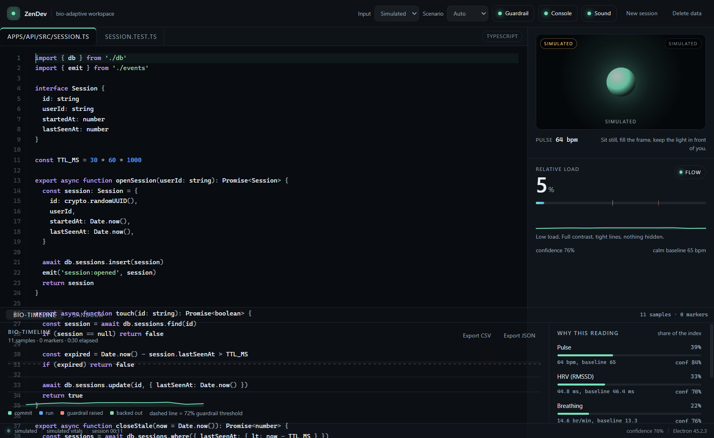
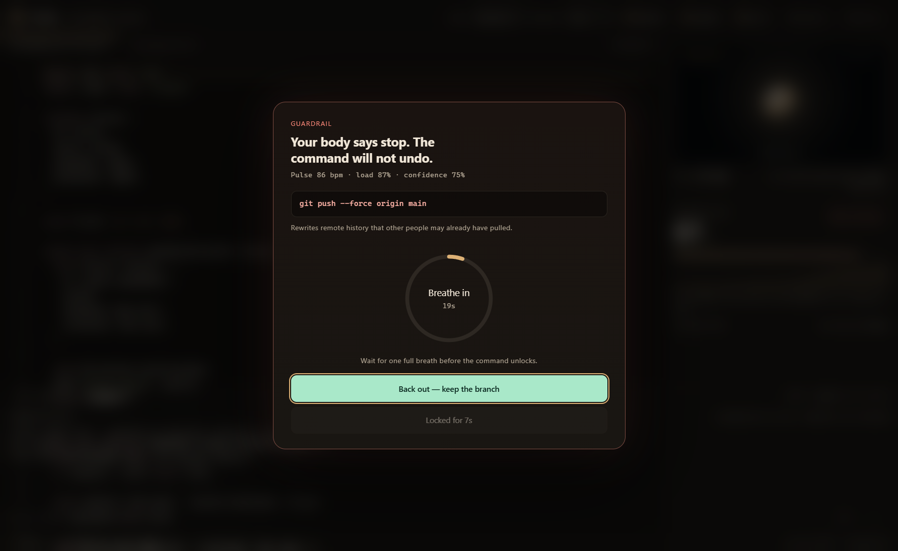

<!--
Draft for the DEV post. The repository is linked below; add the demo video URL before publishing.
Tags: presagechallenge, webdev, typescript, opensource
-->

# I built a workspace that reads my body, then asked it to leave me alone

Most "smart" developer tools add things: another panel, another badge, another notification. I wanted the opposite. ZenDev is a developer workspace that removes friction when I'm calm and adds exactly one thing when I'm not: a breath.

It measures pulse, heart-rate variability and breathing through the Presage SmartSpectra SDK, learns what calm looks like for me, and expresses everything else as a single relative number. The interface cools and opens up when that number is low. When it climbs, lines loosen, the palette warms, and the bio-timeline records it.



## Why relative, not absolute

The SDK gives absolute values — beats per minute, RMSSD in milliseconds, breaths per minute — and it is very easy to build a dashboard that tells people they are stressed. I don't think that is honest. Resting heart rate differs by tens of beats between healthy people, and HRV varies with age, fitness and the time of day.

So ZenDev spends its first ten seconds building a baseline from confident readings only. Every value after that is a difference from that baseline: a z-score mapped to −1…1, then weighted into a load index. A pulse of 85 is not "high". A pulse of 85 when your calm median is 61 is a signal.

That choice changes the whole app. There is no red state by default, no score to optimise, and no population comparison. There is only "you, right now, compared to you ten minutes ago".

## The pipeline

```
phone or laptop camera
   → Presage SmartSpectra SDK (breathing + cardio)
   → per-field cache with 8 s freshness, EMA smoothing with rate limits
   → baseline and weighted load index
   → theme, meter, timeline, terminal guardrail, VS Code status bar
```

Two details mattered more than I expected.

**Partial payloads.** The SDK emits different metrics on different frames. Dropping the last packet when `hrv` is missing made the meter jump. Each metric now carries its own timestamp and confidence, and a value is reused for up to eight seconds before it is shown as missing. A stale number is labelled, never invented.

**Two time constants.** Load rises faster than it falls: a 1.2 s attack and a 5 s release. A single bad frame no longer repaints the app, and the guardrail doesn't flap.

## The guardrail

The sandbox shell intercepts destructive commands — `rm -rf`, `git reset --hard`, `DROP TABLE`. If load is in strain, the command does not run. Instead a breathing ring appears with a single button that stays disabled until you have breathed for eight seconds. The ring has a soft two-note chime when it opens and a higher one when it unlocks.

It is deliberately easy to bypass. This is a speed bump for the version of me that types `git reset --hard` at 96% load, not a security control.



## Two cameras, one SDK

Electron's main process hosts a small HTTPS server and a WebSocket bridge so my phone can act as the camera. The phone page sends 1280×720 JPEG frames at up to 30 fps; the renderer turns them into a `MediaStream` and hands them to the SDK exactly like a webcam. Frames are letterboxed rather than cropped so the forehead region survives on 4:3 sensors.

The phone and the laptop never leave the LAN. The certificate is a locally generated CA, installed once on the phone.

## VS Code, without another dashboard

The desktop app writes its current reading to `~/.zendev/guard.json` every two seconds. A small companion extension reads that file and puts one item in the status bar: `$(pulse) 12% · flow`. If the file is older than fifteen seconds the item disappears, so a dead app never leaves a stale number sitting in the editor.

`ZenDev: Run a command with the guardrail` uses the same rule as the shell: if load is high, an eight-second breathing progress runs first, and cancelling it runs nothing.

## What I chose not to do

- **No diagnosis.** The word "stress" is a label for relative arousal. The app says so on the consent screen, in the tooltip and in every exported trace.
- **No covert capture.** The camera only starts after explicit consent, there is a visible indicator, and the consent and data controls are on the first screen.
- **No cloud.** Frames are processed locally. Telemetry in the SDK is disabled. The only network calls are the SDK's model download and inference.
- **No pretending.** When the face model is unavailable or confidence is low, facial tension is omitted and the meter says "waiting for a confident face frame". A missing value is a missing value.

## Limits

The face and EDA models were not always downloadable during development, so the index falls back to pulse, HRV and breathing, and says which signals it used. Low light, motion, or a small face produce low confidence and no reading. And no reading here is a medical measurement — it is a mirror, not a monitor.

## Try it

```sh
git clone https://github.com/Emanuelmsjv/zendev
cd zendev
npm install
cp .env.example .env      # add SMARTSPECTRA_API_KEY
npm start
```

The VS Code extension lives in `vscode-extension/` and installs as a `.vsix`; the README has the one-line commands.

Demo video: VIDEO_URL

Built for the Presage SmartSpectra SDK Challenge. If you try it, tell me whether the breathing gate feels like a pause or like a punishment — that is the part I am least sure about.
