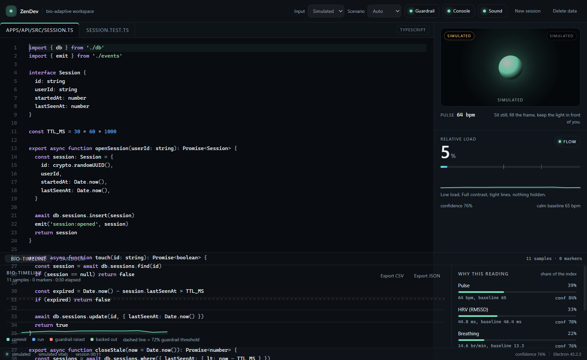
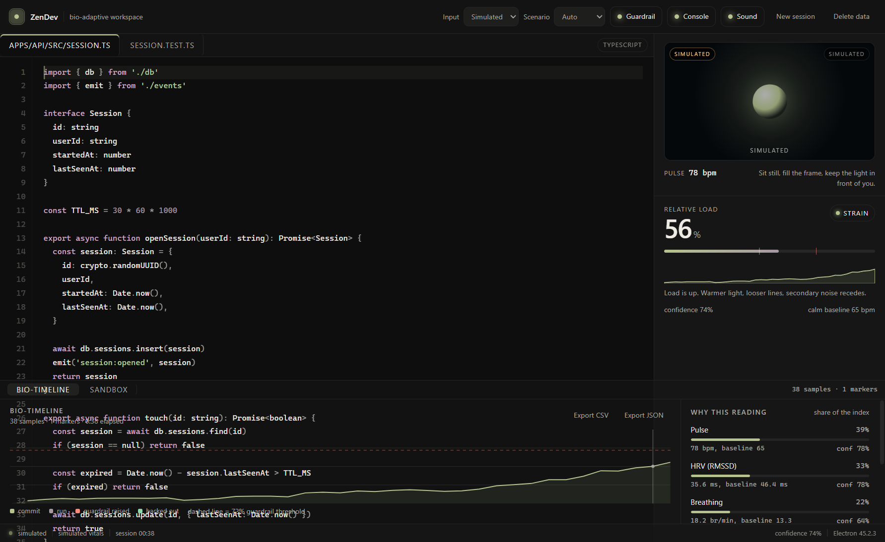
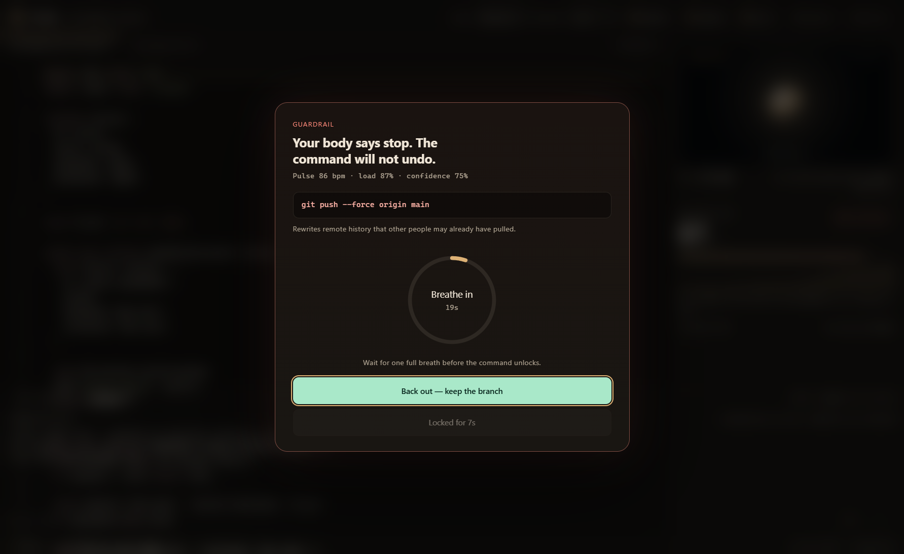

# ZenDev

A developer workspace that reads your body and changes itself.

ZenDev measures pulse, heart-rate variability and breathing through the Presage SmartSpectra SDK, learns a personal calm baseline, and turns the difference into a single relative load number. That number drives the interface, the bio-timeline, and a guardrail that makes you take one full breath before a destructive command runs.

Built for the [Presage SmartSpectra SDK Challenge](https://dev.to/challenges/presage-2026-11-04).



## What it does

- **Live sensors.** Laptop camera, or your phone camera over local Wi-Fi, or a synthetic scenario for demos.
- **Personal baseline.** Ten seconds of confident readings become your calm baseline: median pulse, HRV and breathing rate. Every later reading is shown as a difference from *you*, never from a population.
- **Relative load.** Pulse, HRV, breathing and facial tension (when available) are weighted into a 0–100% index with separate rise and fall time constants, so a single noisy frame cannot flip the whole interface.
- **A workspace that reacts.** Palette, line height and letter spacing interpolate with load. The bio-timeline records the session and marks commands, phase changes and guardrail events.
- **Guardrail.** A destructive command typed into the sandbox shell is intercepted while load is in strain. A breathing ring gates the proceed button, with a chime when it opens and another when it unlocks.
- **VS Code companion.** The same reading appears in the editor status bar, and `ZenDev: Run a command with the guardrail` sends a command to a terminal only after the breathing gate.




## How the reading is built

```
camera / phone frames
        │  (JPEG over WebSocket for the phone, MediaStream for the camera)
        ▼
Presage SmartSpectra SDK  ──  breathing + cardio metrics
        ▼
per-field cache (8 s freshness) + smoothing (EMA + rate limits)
        ▼
baseline (first 10 s of confident readings)  ──►  weighted load index
        ▼
theme, meter, bio-timeline, terminal guardrail, guard-state file, VS Code status bar
```

Metrics used: `breathing.rate`, `cardio.pulseRate`, `cardio.hrv.rmssd`, plus facial expression tension when the face model is available. Skin conductance is included in the model when the SDK reports it. Nothing is inferred from a missing field: a stale or low-confidence value is shown as `—`, not guessed.

## Phone as the camera

1. Start ZenDev and choose **Phone** as the input.
2. Open the pairing URL shown in the dock on the phone (same Wi-Fi).
3. Download and install the local certificate once — Android: *Settings → Security → More security settings → Encryption & credentials → Install a certificate → CA certificate*.
4. Open the camera URL from the pairing page and allow the camera.

The certificate is generated locally and signed by a local CA that never leaves the machine. The phone page sends 1280×720 frames at up to 30 fps over WebSocket to the app, which feeds them to the SDK as a media stream.

## Setup

Requirements: Node 20+ (developed on Node 24), npm, and a Presage API key.

```sh
npm install
cp .env.example .env      # put SMARTSPECTRA_API_KEY=... in it
npm start                 # build + launch Electron
```

`npm run app` runs the Vite dev server with hot reload. `npm test`, `npm run lint` and `npm run build` are the other checks.

Camera and phone input only work in the Electron build, not in the browser preview.

## VS Code extension

`vscode-extension/` is a small TypeScript extension that reads the guard-state file the desktop app writes to `~/.zendev/guard.json`.

```sh
cd vscode-extension
npm install
npm run compile
npx @vscode/vsce package
code --install-extension zendev-vitals-0.1.0.vsix
```

It adds a status-bar item (`$(pulse) 12% · flow`, coloured for strain and guardrail), hides itself when the reading is older than 15 seconds, and contributes two commands: **ZenDev: Run a command with the guardrail** and **ZenDev: Show the current reading**. See [vscode-extension/README.md](vscode-extension/README.md).

## Privacy

- Video frames are processed locally by the SDK and are never uploaded by ZenDev.
- Telemetry is disabled (`enableTelemetry: false`); the only network traffic is the Presage model download and metric inference.
- Settings and the session trace live in local storage; exports are explicit and local.
- The guard-state file contains only load, phase, confidence and timestamps.
- Explicit consent screen on first run, and **Delete data** removes everything ZenDev stored.

## Limits

- Relative arousal, not a medical measurement. A high number means *different from your baseline*, not unwell.
- The face and EDA models are not always downloadable; without them the index uses pulse, HRV and breathing only, and facial tension is omitted rather than faked.
- The phone bridge uses a self-signed local certificate; installation is a one-time step per phone.
- Low light, motion, or a face that is too small produces low confidence, and the app says so instead of showing a number.

## Repository layout

```
electron/       main process, IPC, local phone bridge (HTTPS + WebSocket + CA)
src/            React renderer: hook, lib, components, styles
tests/          vitest suites for the stress model, commands, simulator, theme
vscode-extension/  status-bar reading and guarded command for VS Code
docs/           screenshots
```
